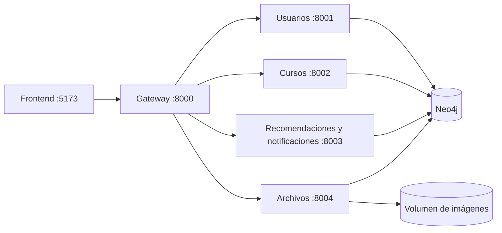

# Lightspace

Red social universitaria para conectar con otras personas, seguir e inscribirse en cursos, publicar en el muro de cada curso y buscar grupo para trabajos. Proyecto final del curso de Bases de Datos.

## Funcionalidades

- Registro, inicio de sesión y perfil con foto.
- Búsqueda de personas, solicitudes y conexiones.
- Publicaciones con hasta 4 imágenes, "me gusta" y comentarios con imagen.
- Catálogo de cursos con portadas, seguir, inscribirse (verificando matrícula) y estrellas.
- Muro de cada curso: preguntas, material y "busco grupo".
- Notificaciones y recomendaciones de personas y cursos.

## Stack

| Capa            | Tecnología                                                                                                                              |
| --------------- | --------------------------------------------------------------------------------------------------------------------------------------- |
| Base de datos   | Neo4j 5.26 Community (en Docker), con la lógica en la base mediante APOC y APOC Extended                                                |
| Backend         | Python 3.13 + FastAPI, dividido en microservicios (usuarios, cursos, recomendaciones y notificaciones, y archivos) detrás de un gateway |
| Frontend        | React + TypeScript + Vite, React Router, TanStack Query, Tailwind CSS + shadcn/ui; en Docker se sirve con nginx                         |
| Infraestructura | Docker Compose                                                                                                                          |

## Equipo

| Integrante       | Rol                                                                                    |
| ---------------- | -------------------------------------------------------------------------------------- |
| Jeronimo Castro  | Frontend + base de datos + gateway e infraestructura (líder técnico)                   |
| Juan Arrieta     | Backend núcleo, servicio de usuarios: cuenta, perfil, conexiones, publicaciones        |
| Juan Caceres     | Backend de cursos, servicio de cursos: catálogo, inscripción, estrellas, muro y grupos |
| Miguel Carrizosa | Backend de recomendaciones y notificaciones, pruebas, informe y sustentación           |

## Requisitos mínimos del proyecto

| Requisito                            | Cómo se cumple                                                                       | Estado                                    |
| ------------------------------------ | ------------------------------------------------------------------------------------ | ----------------------------------------- |
| Docker                               | Docker Compose con Neo4j, los cuatro servicios, el gateway y el frontend             | Cumple                                    |
| API                                  | FastAPI con prefijo `/api`, Swagger por servicio y contrato en `docs/api.md`         | Contrato completo; faltan endpoints       |
| Microservicios                       | Usuarios, cursos, recomendaciones y notificaciones, y archivos, detrás de un gateway | Cumple (la base; falta la lógica de tres) |
| Procedimientos, funciones y triggers | APOC en Neo4j: 4 procedimientos, 2 funciones y 6 triggers (ver `database/logica/`)   | Cumple                                    |
| Vistas                               | 5 procedimientos de solo lectura con consulta fija (ver `docs/modelo-grafo.md`)      | Cumple                                    |

## Requisitos

- **Docker Desktop** con WSL 2 y la virtualización habilitada en la BIOS (SVM Mode en AMD, Intel VT-x en Intel).
- **Git**.
- **Python 3.13**: solo si vas a correr un servicio fuera de Docker.
- **Node.js 24**: solo si vas a desarrollar el frontend fuera de Docker.

## Arquitectura



Cada servicio vive en su propia carpeta, con su `Dockerfile`, sus dependencias y su código en `app/`:

| Carpeta                    | Servicio                         | Responsable |
| -------------------------- | -------------------------------- | ----------- |
| `backend/gateway/`         | Gateway                          | Castro      |
| `backend/usuarios/`        | Usuarios                         | Arrieta     |
| `backend/cursos/`          | Cursos                           | Caceres     |
| `backend/recomendaciones/` | Recomendaciones y notificaciones | Carrizosa   |
| `backend/archivos/`        | Archivos (imágenes)              | Castro      |

- El **gateway** es el único punto de entrada: el frontend solo conoce `http://localhost:8000/api`. Reenvía cada ruta al servicio dueño de su prefijo, responde `/api/health` y gestiona CORS.
- Los servicios **no se llaman entre sí**: comparten una sola base Neo4j.
- Solo **usuarios** emite tokens JWT, y al arrancar aplica `schema.cypher` e instala la lógica de `database/logica/`. Los demás únicamente validan el token con el mismo `JWT_SECRET`.
- **Archivos** recibe las imágenes, les quita los metadatos, las guarda en WebP en dos tamaños y borra cada hora las que nadie usa.
- El detalle de rutas, reglas y responsables está en `docs/api.md`.

## Cómo ejecutar

1. Clona el repositorio (la rama por defecto es `develop`):

   ```bash
   git clone https://github.com/GiROXiO/lightspace.git
   cd lightspace
   ```

2. Crea tu archivo `.env` a partir del ejemplo:

   ```bash
   cp .env.example .env
   ```

   Abre el `.env` y completa:

   | Variable          | Qué poner                                                                     |
   | ----------------- | ----------------------------------------------------------------------------- |
   | `NEO4J_PASSWORD`  | La contraseña que quieras para tu Neo4j local (mínimo 8 caracteres)           |
   | `JWT_SECRET`      | Un texto aleatorio de 32 caracteres o más. Genéralo con el comando de abajo   |
   | `VITE_USAR_MOCKS` | `true` para ver el frontend con datos simulados; `false` para usar el backend |

   ```bash
   python -c "import secrets; print(secrets.token_urlsafe(48))"
   ```

   El `.env` no se sube a GitHub. Cada integrante usa sus propios valores: no hace falta que coincidan. Dentro de tu máquina, todos los servicios reciben el mismo `JWT_SECRET`. Si lo cambias, los tokens anteriores dejan de valer y hay que iniciar sesión otra vez.

3. Abre **Docker Desktop** y espera a que diga _Engine running_.

4. Levanta todo:

   ```bash
   docker compose up -d --build
   ```

   La primera vez necesita internet: descarga las imágenes y el plugin APOC Extended.

5. Comprueba el estado:

   ```bash
   docker compose ps
   ```

   `lightspace-neo4j` debe estar en `healthy` (tarda unos 30 a 60 segundos la primera vez) y `lightspace-usuarios`, `lightspace-cursos`, `lightspace-recomendaciones`, `lightspace-archivos`, `lightspace-gateway` y `lightspace-frontend` en `Up`.

6. Carga los datos de prueba (ver "Datos de prueba"):

   ```bash
   docker compose exec -T usuarios sh -c 'cd /database && python -m seed.main --reset'
   ```

7. Verifica en el navegador:
   - `http://localhost:5173` abre la aplicación.
   - `http://localhost:8000/api/health` debe responder `{"estado":"ok","servicios":{"usuarios":"ok","cursos":"ok","recomendaciones":"ok","archivos":"ok"},...}`. Si algún servicio está caído, responde `503` y nombra cuál.
   - `http://localhost:8001/api/docs` abre el Swagger del servicio de usuarios (`8002` cursos, `8003` recomendaciones, `8004` archivos). El gateway no publica Swagger propio.

El esquema de la base (restricciones e índices) y la lógica (triggers, funciones, procedimientos y vistas) los aplica solo el servicio de usuarios cada vez que arranca.

### Si ya tenías el proyecto levantado (versión con un solo backend)

Después de traer los cambios, reconstruye y elimina el contenedor viejo `lightspace-backend`, que ya no existe:

```bash
git pull
docker compose up -d --build --remove-orphans
```

Añade `VITE_USAR_MOCKS` a tu `.env`. Si el seed cambió, vuelve a cargar los datos de prueba (ver "Datos de prueba").

## Servicios

| Servicio                         | URL                              | Notas                                                                      |
| -------------------------------- | -------------------------------- | -------------------------------------------------------------------------- |
| Aplicación (frontend)            | `http://localhost:5173`          |                                                                            |
| API (gateway)                    | `http://localhost:8000/api`      | Punto de entrada único. Todas las rutas llevan el prefijo `/api`           |
| Usuarios                         | `http://localhost:8001/api/docs` | Swagger propio y `GET /health` interno                                     |
| Cursos                           | `http://localhost:8002/api/docs` | Swagger propio y `GET /health` interno                                     |
| Recomendaciones y notificaciones | `http://localhost:8003/api/docs` | Swagger propio y `GET /health` interno                                     |
| Archivos                         | `http://localhost:8004/api/docs` | Swagger propio y `GET /health` interno                                     |
| Neo4j Browser                    | `http://localhost:7474`          | Conectar a `bolt://localhost:7687`, usuario `neo4j`, contraseña del `.env` |

## Frontend

### Datos simulados o backend real

Con `VITE_USAR_MOCKS=true` el frontend no llama a la API: los datos viven en el navegador y sirven para ver y probar las pantallas. Solo funcionan las cuentas `demo.sistemas` y `demo.industrial` y las que registres ahí. Para volver al estado inicial, ejecuta `localStorage.clear()` en la consola del navegador.

Para usar el backend real, pon `VITE_USAR_MOCKS=false` en el `.env` y reconstruye:

```bash
docker compose up -d --build frontend
```

### Desarrollo

Para editar con recarga automática, detén el contenedor (usa el mismo puerto) y arranca Vite:

```bash
docker compose stop frontend
cd frontend
npm install
npm run dev
```

En este caso la configuración se lee de `frontend/.env` (ver `frontend/.env.example`). `npm run build` compila y revisa los tipos; `npm run lint` revisa el código.

| Carpeta                    | Contenido                                         |
| -------------------------- | ------------------------------------------------- |
| `frontend/src/paginas/`    | Una pantalla por archivo                          |
| `frontend/src/components/` | Componentes compartidos (`ui/` son los de shadcn) |
| `frontend/src/lib/`        | Cliente de la API y consultas por tema            |
| `frontend/src/mocks/`      | Datos y rutas simuladas                           |
| `frontend/src/sesion/`     | Sesión y rutas protegidas                         |
| `frontend/src/types/`      | Tipos del contrato                                |

## Base de datos

- **Cada integrante tiene su propia base local.** No se comparte en la nube: lo que se comparte es el código y el esquema, vía GitHub.
- **Cómo se crea:** la primera vez que ejecutas `docker compose up`, el volumen `lightspace_neo4j_data` está vacío y Neo4j se inicializa solo, con el usuario `neo4j` y la contraseña de `NEO4J_PASSWORD` (tu `.env`). Esa contraseña queda guardada dentro del volumen.
- **Cambiar la contraseña del `.env` después no la modifica**, porque Neo4j ya la guardó. Para empezar de cero (se borran los datos y las imágenes subidas):

  ```bash
  docker compose down -v
  docker compose up -d --build
  ```

- **Neo4j Desktop no es necesario.** Si lo tienes, no enciendas una instancia suya mientras usas Docker: ambas usan el puerto 7687.
- **Modelo:** ver `docs/modelo-grafo.md`. Es la fuente de verdad de nodos, relaciones y reglas de negocio.

### Esquema

`database/schema.cypher` define las restricciones de unicidad y los índices. Es idempotente (`IF NOT EXISTS`) y el servicio de usuarios lo aplica al arrancar. Para aplicarlo a mano:

```bash
docker compose exec -T neo4j sh -c 'cypher-shell -u neo4j -p "${NEO4J_AUTH#neo4j/}"' < database/schema.cypher
```

Para **cambiar** una restricción o un índice que ya existe, `IF NOT EXISTS` no lo reemplaza (compara solo el nombre). Bórralo primero en Neo4j Browser y vuelve a aplicar el archivo:

```cypher
DROP CONSTRAINT nombre_de_la_restriccion IF EXISTS
DROP INDEX nombre_del_indice IF EXISTS
```

### Lógica en la base de datos

Triggers, procedimientos, funciones y vistas se implementan con el plugin APOC de Neo4j, bajo el espacio de nombres `lightspace`. El código está en `database/logica/` y el catálogo con entradas y salidas en `docs/modelo-grafo.md`.

| Tipo           | Cantidad | Archivo                 |
| -------------- | -------- | ----------------------- |
| Triggers       | 6        | `triggers.cypher`       |
| Funciones      | 2        | `funciones.cypher`      |
| Procedimientos | 4        | `procedimientos.cypher` |
| Vistas         | 5        | `vistas.cypher`         |

El servicio de usuarios los instala al arrancar. Si cambias un archivo:

```bash
docker compose restart usuarios
```

Para probarlos en Neo4j Browser (con los datos de prueba cargados):

```cypher
MATCH (u:Usuario {email: 'demo.sistemas@lightspace.example.com'})
CALL custom.lightspace.recomendar_personas(u.id, 3) YIELD nombre, score
RETURN nombre, score
```

Para listar lo instalado, primero `:use system` y luego `CALL apoc.trigger.show('neo4j')` o `CALL apoc.custom.show('neo4j')`.

### Imágenes

Los archivos subidos viven en el volumen `lightspace_archivos_data`; en el grafo solo se guarda su dirección. Las portadas de curso están en `database/portadas/` y no se modifican desde la aplicación. Para volver a generarlas (en Git Bash):

```bash
MSYS_NO_PATHCONV=1 docker compose run --rm --no-deps -v ./database:/database archivos sh -c 'cd /database && python generar_portadas.py'
```

### Datos de prueba (seed)

Carga un conjunto determinista de datos simulados: programas, cursos, usuarios, matrículas, publicaciones, comentarios, conexiones y notificaciones. Los prefijos de materia (IST, MAT, LEY...) son los reales de la universidad; todo lo demás es simulado.

```bash
docker compose exec -T usuarios sh -c 'cd /database && python -m seed.main --reset'
```

| Opción         | Efecto                                           | Por defecto |
| -------------- | ------------------------------------------------ | ----------- |
| `--reset`      | **Borra toda la base** antes de cargar           | desactivado |
| `--usuarios N` | Cantidad de usuarios                             | 120         |
| `--semilla N`  | Semilla aleatoria (misma semilla = mismos datos) | 42          |
| `--dry-run`    | Genera y valida sin tocar Neo4j                  | desactivado |

Detalles del seed:

- **NRC:** 4 dígitos, nunca empiezan en 0. Las 3 secciones de cada curso tienen NRC consecutivos; cursos distintos no siguen ningún orden.
- **Dos periodos:** hay matrículas en el periodo vigente (`202630`) y en el anterior (`202610`), este último como historial. Solo el vigente cuenta para inscribirse.
- **Estrellas:** pueden ser de cualquier usuario, no solo de quien sigue o está inscrito.
- **Volumen del cronograma:** para 400 usuarios, `--usuarios 400`.
- **Triggers:** el seed los pausa mientras carga, para no duplicar notificaciones.
- Si el seed cambia, hay que volver a ejecutarlo con `--reset` para tener los datos nuevos en tu base local.

Cuentas demo (contraseña de todas: `Lightspace123!`):

| Email                                    | Perfil                                                 |
| ---------------------------------------- | ------------------------------------------------------ |
| `demo.sistemas@lightspace.example.com`   | Sistemas, semestre 6, con todos sus cursos inscritos   |
| `demo.industrial@lightspace.example.com` | Industrial, semestre 5, con todos sus cursos inscritos |
| `demo.derecho@lightspace.example.com`    | Derecho, semestre 4                                    |
| `demo.medicina@lightspace.example.com`   | Medicina, semestre 3                                   |
| `demo.nuevo@lightspace.example.com`      | Recién registrado: sin matrículas, conexiones ni posts |

## Desarrollo del backend

El backend corre en Docker y cada servicio recarga solo al guardar cambios en su carpeta `app/`. Para editar con autocompletado y probar fuera de Docker, un solo entorno virtual sirve para todos (usuarios, cursos y recomendaciones comparten el mismo `requirements.txt`; archivos añade `pillow` y `python-multipart`):

```bash
cd backend
python -m venv .venv
source .venv/Scripts/activate      # Git Bash en Windows (en Linux/Mac: source .venv/bin/activate)
pip install -r usuarios/requirements.txt
pip install -r archivos/requirements.txt
```

Si quieres ejecutar un servicio fuera de Docker, detén antes su contenedor para liberar el puerto y arráncalo desde su carpeta (ejemplo con usuarios, puerto 8001; cursos usa 8002, recomendaciones 8003, archivos 8004 y el gateway 8000):

```bash
docker compose stop usuarios
cd usuarios
uvicorn app.main:app --reload --port 8001
```

Convenciones:

- Todas las rutas van bajo el prefijo `/api`.
- Cada endpoint pide su sesión de Neo4j con `Depends(db.get_session)`.
- El periodo vigente es `periodo_actual` (por defecto `202630`) en el `config.py` de cada servicio.
- La lógica que ya está en la base se llama con `CALL custom.lightspace.xxx(...)`; no se repite en Python.
- Al agregar una librería: `pip install paquete` y `pip freeze > requirements.txt` (desde Git Bash, con el entorno activo), en el `requirements.txt` del servicio al que pertenece.
- Cada módulo va en su propio archivo dentro de `app/` de su servicio y se registra en el `main.py` de ese servicio.
- Si añades un prefijo de ruta nuevo, regístralo también en `RUTAS` de `backend/gateway/app/main.py`; si no, el gateway responde `404`.
- Autenticación con JWT en el encabezado `Authorization: Bearer <token>`. El servicio de usuarios lo emite (`backend/usuarios/app/auth.py`); los demás lo validan con su `app/seguridad.py`. Los endpoints protegidos usan `Depends(get_usuario_actual)`, que devuelve `{"id": ...}`.
- Cada integrante trabaja en la carpeta de su servicio; tocar el de otro se hace por Pull Request y con su revisión.
- Solo el servicio de usuarios aplica `schema.cypher` al arrancar.
- CORS lo gestiona el gateway (`backend/gateway/app/config.py`, origen permitido por defecto `http://localhost:5173`); los servicios no lo configuran.
- Rutas, entradas y respuestas: ver `docs/api.md`. Si cambias algo, actualiza ese archivo **antes** de implementarlo y avisa al grupo.

## Flujo de trabajo

- `main` siempre funciona. `develop` es la rama de integración.
- Una rama por tarea (`feat/...`, `fix/...`, `docs/...`) que entra a `develop` por **Pull Request**.
- Prefijos de commit: `chore:`, `feat:`, `fix:`, `docs:`.
- Un endpoint está **terminado** cuando: funciona en Swagger con datos de prueba, su efecto se verificó en Neo4j Browser, tiene al menos una prueba automatizada y está documentado.

## Cortes

Cada integrante trabaja a su ritmo, pero debe llegar a cada corte con lo suyo terminado, en `develop`. Esa noche hay una revisión de 15 minutos por llamada. Quien no llegue avisa con 24 horas de anticipación.

| Corte   | Fecha                    | Contenido                                                                                         |
| ------- | ------------------------ | ------------------------------------------------------------------------------------------------- |
| 1       | Jueves 19 de noviembre   | Login, perfil y lista de cursos de punta a punta                                                  |
| 2       | Lunes 23 de noviembre    | Conexiones, publicaciones e inscripción con verificación de matrícula                             |
| 3       | Viernes 27 de noviembre  | Congelamiento de funcionalidades: muro del curso, "busco grupo", notificaciones y recomendaciones |
| 4       | Lunes 30 de noviembre    | Versión candidata                                                                                 |
| Entrega | Miércoles 2 de diciembre | Entrega final                                                                                     |

Lo que falta para la versión candidata: los endpoints de usuarios, cursos, y recomendaciones y notificaciones; conectar el frontend con ellos (`VITE_USAR_MOCKS=false`); las pruebas y el informe.

## Comandos útiles

| Comando                                                                               | Qué hace                                                                                                |
| ------------------------------------------------------------------------------------- | ------------------------------------------------------------------------------------------------------- |
| `docker compose up -d --build`                                                        | Levanta (y reconstruye) todos los servicios                                                             |
| `docker compose up -d --build --remove-orphans`                                       | Igual, y elimina contenedores de servicios que ya no existen (tras actualizar)                          |
| `docker compose up -d --build frontend`                                               | Reconstruye solo el frontend                                                                            |
| `docker compose ps`                                                                   | Estado de los contenedores                                                                              |
| `docker compose logs -f usuarios`                                                     | Logs de un servicio en vivo (`cursos`, `recomendaciones`, `archivos`, `gateway`; `Ctrl + C` para salir) |
| `docker compose logs neo4j`                                                           | Logs de Neo4j                                                                                           |
| `docker compose restart cursos`                                                       | Reinicia un servicio                                                                                    |
| `docker compose stop`                                                                 | Apaga los contenedores (los datos se conservan)                                                         |
| `docker compose down`                                                                 | Apaga y elimina los contenedores (los datos se conservan)                                               |
| `docker compose down -v`                                                              | Elimina también los volúmenes: **borra los datos y las imágenes**                                       |
| `docker compose exec -T usuarios sh -c 'cd /database && python -m seed.main --reset'` | Recarga los datos de prueba (**borra la base**)                                                         |
| `curl -i http://localhost:8000/api/health`                                            | Estado del gateway y de los servicios                                                                   |

## Solución de problemas

| Problema                                                           | Causa y solución                                                                                                       |
| ------------------------------------------------------------------ | ---------------------------------------------------------------------------------------------------------------------- |
| `failed to connect to the docker API ... dockerDesktopLinuxEngine` | Docker Desktop no está encendido. Ábrelo y espera _Engine running_                                                     |
| Docker Desktop dice _Virtualization is disabled in firmware_       | Habilita la virtualización en la BIOS (SVM Mode en AMD, Intel VT-x en Intel)                                           |
| `lightspace-neo4j` no llega a `healthy`                            | Revisa `docker compose logs neo4j`. Si el volumen tiene otra contraseña, usa `docker compose down -v`                  |
| Un servicio no arranca con un error de validación                  | Falta `NEO4J_PASSWORD` (mínimo 8 caracteres) o `JWT_SECRET` (mínimo 32) en el `.env` (paso 2 de "Cómo ejecutar")       |
| `/api/health` responde `503`                                       | Un servicio está caído o arrancando; el mensaje dice cuál. Mira `docker compose ps` y `docker compose logs <servicio>` |
| Una ruta responde `404` con "La ruta no existe"                    | El prefijo no está registrado en `RUTAS` de `backend/gateway/app/main.py`, o la ruta está mal escrita                  |
| El inicio de sesión dice "Not Found"                               | `VITE_USAR_MOCKS=false` y ese endpoint todavía no está implementado                                                    |
| Cambié el `.env` o el frontend y no se ve                          | Reconstruye: `docker compose up -d --build frontend`                                                                   |
| Los datos simulados quedaron raros                                 | Ejecuta `localStorage.clear()` en la consola del navegador y recarga                                                   |
| Las portadas no aparecen                                           | El backend está apagado o faltan en `database/portadas/` (ver "Imágenes")                                              |
| Aparece el contenedor viejo `lightspace-backend`                   | Quedó de la versión con un solo backend. Usa `docker compose up -d --build --remove-orphans`                           |
| `failed to read dockerfile`                                        | Cada servicio necesita su `Dockerfile` exactamente con ese nombre, sin extensión, en su carpeta                        |
| Puerto 8000 a 8004 ocupado                                         | Hay un `uvicorn` local corriendo. Detenlo con `Ctrl + C`                                                               |
| Puerto 5173 ocupado                                                | Hay un `npm run dev` abierto, o el contenedor del frontend está encendido                                              |
| Puerto 7687 ocupado                                                | Hay una instancia de Neo4j Desktop encendida. Apágala                                                                  |
| La contraseña del `.env` no funciona                               | Se cambió después de crear el volumen. Usa `docker compose down -v`                                                    |
| Swagger responde `401` en una ruta protegida                       | Falta el token. En Swagger usa el botón _Authorize_ y pega el `access_token` que devuelve `/api/auth/login`            |

## Documentación

- `docs/modelo-grafo.md`: modelo del grafo, reglas de negocio y lógica en la base de datos (triggers, procedimientos, funciones y vistas).
- `docs/api.md`: arquitectura de servicios y contrato de la API (cuentas, perfil, conexiones, publicaciones, cursos, grupos, notificaciones, recomendaciones e imágenes).

## Estado

- [x] Repositorio, ramas y convenciones
- [x] Neo4j en Docker
- [x] Modelo del grafo
- [x] Esquema de la base
- [x] Backend base (`/api/health`)
- [x] Seed de datos
- [x] Contrato de la API (`docs/api.md`)
- [x] Configuración de JWT
- [x] Arquitectura de servicios: usuarios, cursos, recomendaciones y gateway con CORS
- [x] Servicio de archivos e imágenes
- [x] APOC: triggers, procedimientos, funciones y vistas
- [x] Frontend base
- [x] Pantallas del frontend (con datos simulados)
- [x] Frontend en Docker
- [ ] Endpoints de usuarios
- [ ] Endpoints de cursos
- [ ] Endpoints de recomendaciones y notificaciones
- [ ] Frontend conectado al backend real
- [ ] Pruebas automatizadas e informe
