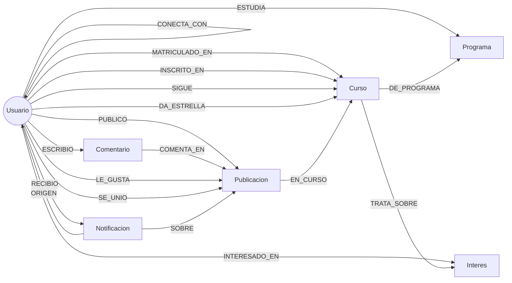

# Modelo del grafo

Documento vivo. Responsable: Jeronimo Castro. Cualquier cambio al modelo se avisa al grupo y se actualiza aquí.

## Diagrama

## Nodos

| Nodo           | Propiedades                                                                                                            | Notas                                                                                                                                                                                                              |
| -------------- | ---------------------------------------------------------------------------------------------------------------------- | ------------------------------------------------------------------------------------------------------------------------------------------------------------------------------------------------------------------ |
| `Usuario`      | `id`, `nombre`, `apellido`, `email`, `codigo`, `semestre`, `bio`, `password_hash`, `fecha_registro`                    | `id`, `email` y `codigo` únicos. Nunca se guarda la contraseña en claro                                                                                                                                            |
| `Programa`     | `id`, `codigo`, `nombre`, `facultad`                                                                                   | `id`, `codigo` y `nombre` únicos. Carrera                                                                                                                                                                          |
| `Curso`        | `id`, `codigo`, `materia`, `numero`, `nombre`, `descripcion`, `creditos`, `nivel`, `semestre_sugerido`, `departamento` | `id` y `codigo` únicos. Es la asignatura, no la sección. `codigo` = `materia` + `numero` (ej. `IST 4360`). `nivel`: `Pregrado` o `Posgrado`, como en el registro. `semestre_sugerido`: semestre típico en la malla |
| `Interes`      | `nombre`                                                                                                               | Único. Ej.: Programación, Música                                                                                                                                                                                   |
| `Publicacion`  | `id`, `tipo`, `contenido`, `fecha` y, según el tipo, `enlace`, `actividad`, `cupos`, `estado`                          | `tipo`: `GENERAL`, `MATERIAL`, `PREGUNTA`, `BUSCA_GRUPO`. `estado` (solo `BUSCA_GRUPO`): `ABIERTA` o `CERRADA`                                                                                                     |
| `Comentario`   | `id`, `contenido`, `fecha`                                                                                             |                                                                                                                                                                                                                    |
| `Notificacion` | `id`, `tipo`, `mensaje`, `leida`, `fecha`                                                                              | `tipo`: `SOLICITUD_CONEXION`, `CONEXION_ACEPTADA`, `COMENTARIO`, `LIKE`, `RESPUESTA_GRUPO`                                                                                                                         |

## Relaciones

| Relación                                    | Propiedades                                  | Significado                                                                                                               |
| ------------------------------------------- | -------------------------------------------- | ------------------------------------------------------------------------------------------------------------------------- |
| `(Usuario)-[:ESTUDIA]->(Programa)`          |                                              | Carrera del usuario                                                                                                       |
| `(Usuario)-[:INTERESADO_EN]->(Interes)`     |                                              | Gustos                                                                                                                    |
| `(Usuario)-[:CONECTA_CON]->(Usuario)`       | `estado` (`PENDIENTE` o `ACEPTADA`), `desde` | La dirección indica quién envió la solicitud. Se consulta sin dirección                                                   |
| `(Usuario)-[:MATRICULADO_EN]->(Curso)`      | `periodo`, `nrc`                             | Registro académico simulado: fuente de verdad para verificar matrícula                                                    |
| `(Usuario)-[:INSCRITO_EN]->(Curso)`         | `desde`, `periodo`, `nrc`                    | Inscrito en la plataforma. Solo si existe `MATRICULADO_EN` en el periodo vigente. Copia `periodo` y `nrc` de la matrícula |
| `(Usuario)-[:SIGUE]->(Curso)`               | `desde`                                      | Acceso al material sin estar matriculado                                                                                  |
| `(Usuario)-[:DA_ESTRELLA]->(Curso)`         | `fecha`                                      | Una por usuario y curso                                                                                                   |
| `(Curso)-[:DE_PROGRAMA]->(Programa)`        |                                              | Carreras a las que aplica el curso                                                                                        |
| `(Curso)-[:TRATA_SOBRE]->(Interes)`         |                                              | Temas del curso                                                                                                           |
| `(Usuario)-[:PUBLICO]->(Publicacion)`       |                                              | Autor                                                                                                                     |
| `(Publicacion)-[:EN_CURSO]->(Curso)`        |                                              | Opcional: publicación del muro de un curso                                                                                |
| `(Usuario)-[:ESCRIBIO]->(Comentario)`       |                                              | Autor del comentario                                                                                                      |
| `(Comentario)-[:COMENTA_EN]->(Publicacion)` |                                              | Publicación comentada                                                                                                     |
| `(Usuario)-[:LE_GUSTA]->(Publicacion)`      | `fecha`                                      |                                                                                                                           |
| `(Usuario)-[:SE_UNIO]->(Publicacion)`       | `fecha`                                      | Integrante de un grupo (`BUSCA_GRUPO`)                                                                                    |
| `(Usuario)-[:RECIBIO]->(Notificacion)`      |                                              | Destinatario                                                                                                              |
| `(Notificacion)-[:ORIGEN]->(Usuario)`       |                                              | Quién la generó                                                                                                           |
| `(Notificacion)-[:SOBRE]->(Publicacion)`    |                                              | Publicación relacionada                                                                                                   |

## Periodo académico y NRC

- `periodo` es texto con formato `AAAA` + `10`, `20` o `30`: `10` primer semestre, `20` vacacional, `30` segundo semestre. Ej.: `202630`.
- `nrc` es texto. Identifica una sección concreta de un curso **en un periodo**, así que solo es único dentro de ese periodo. Por eso vive en la relación y no en `Curso`.
- El **periodo vigente** se configura en el backend (`PERIODO_ACTUAL`, por ahora `202630`).

## Reglas de negocio

- **Seguir** un curso: cualquier usuario, sin verificación. Da acceso al material.
- **Inscribirse**: solo si existe `MATRICULADO_EN` con `periodo` igual al periodo vigente. Al inscribirse se copian `periodo` y `nrc` a `INSCRITO_EN` y se elimina `SIGUE` (son excluyentes).
- **Estrella**: solo quien sigue o está inscrito. Una por usuario y curso.
- **Publicar material y pedir grupo** (`MATERIAL`, `BUSCA_GRUPO`): solo inscritos. **Preguntar**: inscritos y seguidores.
- **Grupo**: los demás inscritos responden con comentario o `SE_UNIO`. Al llenarse los `cupos`, el `estado` pasa a `CERRADA`.
- **Recomendar cursos**: filtro por carrera del usuario (`DE_PROGRAMA`); después, intereses en común, cursos que siguen usuarios parecidos y estrellas.
- **Recomendar personas**: conexiones en común, cursos compartidos, misma carrera e intereses en común.
- **Relaciones sin duplicados**: Neo4j no impone unicidad en relaciones. Las consultas que crean `CONECTA_CON`, `MATRICULADO_EN`, `INSCRITO_EN`, `SIGUE`, `DA_ESTRELLA`, `LE_GUSTA` y `SE_UNIO` usan `MERGE`, nunca `CREATE`.
- Todas las fechas se guardan como `datetime` de Neo4j. El driver de Python las devuelve como `neo4j.time.DateTime`; se convierten con `.to_native()`.
- La matrícula es única por (usuario, curso, periodo): se crea con `MERGE` incluyendo `{periodo: ...}`.
- Las contraseñas se guardan con Argon2 (`pwdlib`, `PasswordHash.recommended()`) en el campo `password_hash`. Nunca en texto plano.

## Pendiente (fases posteriores)

- Nodo `Profesor` y relación `DICTA`, para recomendar profesores.
- Nodo `Seccion` (NRC, periodo, horario, profesor), si se necesita modelar las secciones del registro. Hoy el `nrc` vive en `MATRICULADO_EN` e `INSCRITO_EN`.
