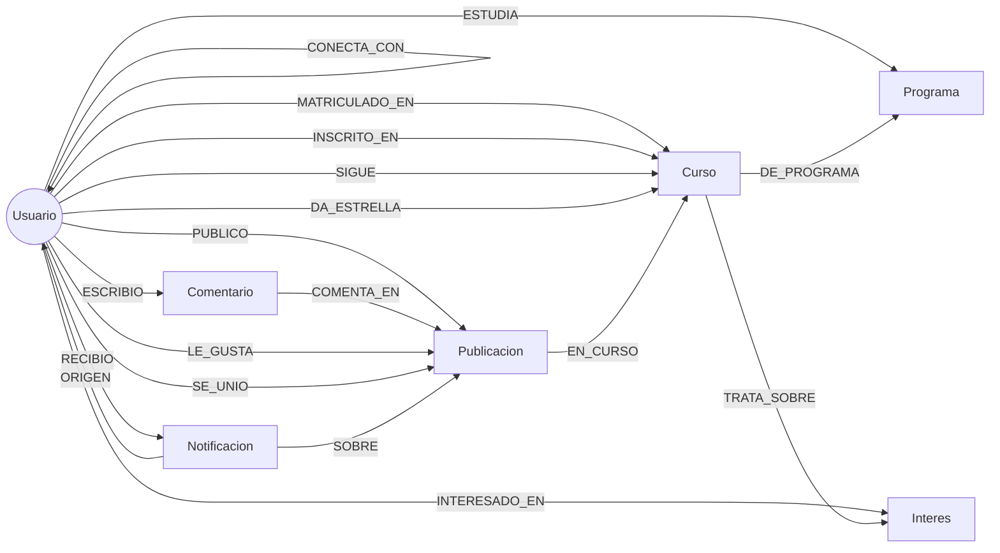

# Modelo del grafo

Documento vivo. Responsable: Jeronimo Castro. Cualquier cambio al modelo se avisa al grupo y se actualiza aquí.

## Diagrama

## Nodos

| Nodo           | Propiedades                                                                                                                           | Notas                                                                                                                                                                                                                                                             |
| -------------- | ------------------------------------------------------------------------------------------------------------------------------------- | ----------------------------------------------------------------------------------------------------------------------------------------------------------------------------------------------------------------------------------------------------------------- |
| `Usuario`      | `id`, `nombre`, `apellido`, `email`, `codigo`, `semestre`, `bio`, `password_hash`, `fecha_registro`, `foto_url`                       | `id`, `email` y `codigo` únicos. Nunca se guarda la contraseña en claro. `foto_url` es opcional                                                                                                                                                                   |
| `Programa`     | `id`, `codigo`, `nombre`, `facultad`                                                                                                  | `id`, `codigo` y `nombre` únicos. Carrera                                                                                                                                                                                                                         |
| `Curso`        | `id`, `codigo`, `materia`, `numero`, `nombre`, `descripcion`, `creditos`, `nivel`, `semestre_sugerido`, `departamento`, `portada_url` | `id` y `codigo` únicos. Es la asignatura, no la sección. `codigo` = `materia` + `numero` (ej. `IST 4360`). `nivel`: `Pregrado` o `Posgrado`, como en el registro. `semestre_sugerido`: semestre típico en la malla. `portada_url` la carga el seed (solo lectura) |
| `Interes`      | `nombre`                                                                                                                              | Único. Ej.: Programación, Música                                                                                                                                                                                                                                  |
| `Publicacion`  | `id`, `tipo`, `contenido`, `fecha`, `imagenes` y, según el tipo, `enlace`, `actividad`, `cupos`, `estado`                             | `tipo`: `GENERAL`, `MATERIAL`, `PREGUNTA`, `BUSCA_GRUPO`. `estado` (solo `BUSCA_GRUPO`): `ABIERTA` o `CERRADA`. `imagenes`: lista de hasta 4 direcciones                                                                                                          |
| `Comentario`   | `id`, `contenido`, `fecha`, `imagen_url`                                                                                              | `imagen_url` es opcional                                                                                                                                                                                                                                          |
| `Notificacion` | `id`, `tipo`, `mensaje`, `leida`, `fecha`                                                                                             | `tipo`: `SOLICITUD_CONEXION`, `CONEXION_ACEPTADA`, `COMENTARIO`, `LIKE`, `RESPUESTA_GRUPO`                                                                                                                                                                        |
|                |

## Relaciones

| Relación                                    | Propiedades                                  | Significado                                                                                                               |
| ------------------------------------------- | -------------------------------------------- | ------------------------------------------------------------------------------------------------------------------------- |
| `(Usuario)-[:ESTUDIA]->(Programa)`          |                                              | Carrera del usuario                                                                                                       |
| `(Usuario)-[:INTERESADO_EN]->(Interes)`     |                                              | Gustos                                                                                                                    |
| `(Usuario)-[:CONECTA_CON]->(Usuario)`       | `estado` (`PENDIENTE` o `ACEPTADA`), `desde` | La dirección indica quién envió la solicitud. Se consulta sin dirección                                                   |
| `(Usuario)-[:MATRICULADO_EN]->(Curso)`      | `periodo`, `nrc`                             | Registro académico simulado: fuente de verdad para verificar matrícula                                                    |
| `(Usuario)-[:INSCRITO_EN]->(Curso)`         | `desde`, `periodo`, `nrc`                    | Inscrito en la plataforma. Solo si existe `MATRICULADO_EN` en el periodo vigente. Copia `periodo` y `nrc` de la matrícula |
| `(Usuario)-[:SIGUE]->(Curso)`               | `desde`                                      | Acceso al material sin estar matriculado                                                                                  |
| `(Usuario)-[:DA_ESTRELLA]->(Curso)`         | `fecha`                                      | Estadística de recomendación del curso. Una por usuario y curso. No depende de seguir ni de estar inscrito                |
| `(Curso)-[:DE_PROGRAMA]->(Programa)`        |                                              | Carreras a las que aplica el curso                                                                                        |
| `(Curso)-[:TRATA_SOBRE]->(Interes)`         |                                              | Temas del curso                                                                                                           |
| `(Usuario)-[:PUBLICO]->(Publicacion)`       |                                              | Autor                                                                                                                     |
| `(Publicacion)-[:EN_CURSO]->(Curso)`        |                                              | Opcional: publicación del muro de un curso                                                                                |
| `(Usuario)-[:ESCRIBIO]->(Comentario)`       |                                              | Autor del comentario                                                                                                      |
| `(Comentario)-[:COMENTA_EN]->(Publicacion)` |                                              | Publicación comentada                                                                                                     |
| `(Usuario)-[:LE_GUSTA]->(Publicacion)`      | `fecha`                                      |                                                                                                                           |
| `(Usuario)-[:SE_UNIO]->(Publicacion)`       | `fecha`                                      | Integrante de un grupo (`BUSCA_GRUPO`)                                                                                    |
| `(Usuario)-[:RECIBIO]->(Notificacion)`      |                                              | Destinatario                                                                                                              |
| `(Notificacion)-[:ORIGEN]->(Usuario)`       |                                              | Quién la generó                                                                                                           |
| `(Notificacion)-[:SOBRE]->(Publicacion)`    |                                              | Publicación relacionada                                                                                                   |

## Imágenes

Los archivos no se guardan en el grafo: viven en un volumen del servicio de archivos y en los nodos solo queda su dirección (texto). Las portadas de curso vienen en el repositorio, las carga el seed y no se modifican desde la aplicación. El servicio de archivos lee el grafo para borrar las imágenes que ya nadie usa. No hacen falta restricciones ni índices nuevos.

## Periodo académico y NRC

- `periodo` es texto con formato `AAAA` + `10`, `20` o `30`: `10` primer semestre, `20` vacacional, `30` segundo semestre. Ej.: `202630`.
- `nrc` es texto de **4 dígitos** que nunca empieza en 0 (convención de la universidad). Las secciones de un mismo curso en un periodo tienen NRC consecutivos (ej. `1890` a `1893`); cursos distintos no siguen ningún orden entre sí. Identifica una sección concreta de un curso **en un periodo**, así que solo es único dentro de ese periodo. Por eso vive en la relación y no en `Curso`.
- El **periodo vigente** se configura en el backend (`PERIODO_ACTUAL`, por ahora `202630`).

## Reglas de negocio

- **Seguir** un curso: cualquier usuario, sin verificación. Sirve para tenerlo en "Mis cursos" y para las recomendaciones. No es un permiso: el muro de un curso lo ve cualquier usuario con sesión.
- **Inscribirse**: solo si existe `MATRICULADO_EN` con `periodo` igual al periodo vigente. Al inscribirse se copian `periodo` y `nrc` a `INSCRITO_EN` y se elimina `SIGUE` (son excluyentes). La validación y la exclusión viven en el procedimiento `lightspace.inscribir` (ver "Lógica en la base de datos").
- **Estrella**: cualquier usuario autenticado puede dar estrella a cualquier curso, como en GitHub. Es una estadística aparte que indica qué tan recomendado es el curso: no depende de seguirlo ni de estar inscrito, y dejar de seguir no la quita. Una por usuario y curso; el usuario puede quitarla.
- **Publicar material y pedir grupo** (`MATERIAL`, `BUSCA_GRUPO`): solo inscritos. **Preguntar**: inscritos y seguidores.
- **Grupo**: los demás inscritos responden con comentario o `SE_UNIO`. Al llenarse los `cupos`, el `estado` pasa a `CERRADA` (lo hace el trigger `cerrar_grupo`, no el backend).
- **Recomendar cursos**: filtro por carrera del usuario (`DE_PROGRAMA`); después, intereses en común, cursos que siguen usuarios parecidos y estrellas.
- **Recomendar personas**: conexiones en común, cursos compartidos, misma carrera e intereses en común.
- **Relaciones sin duplicados**: Neo4j no impone unicidad en relaciones. Las consultas que crean `CONECTA_CON`, `MATRICULADO_EN`, `INSCRITO_EN`, `SIGUE`, `DA_ESTRELLA`, `LE_GUSTA` y `SE_UNIO` usan `MERGE`, nunca `CREATE`.
- Todas las fechas se guardan como `datetime` de Neo4j. El driver de Python las devuelve como `neo4j.time.DateTime`; se convierten con `.to_native()`.
- La matrícula es única por (usuario, curso, periodo): se crea con `MERGE` incluyendo `{periodo: ...}`.
- Las contraseñas se guardan con Argon2 (`pwdlib`, `PasswordHash.recommended()`) en el campo `password_hash`. Nunca en texto plano.

## Lógica en la base de datos

> Se implementa con el plugin APOC de Neo4j, porque Neo4j Community no permite crear procedimientos, funciones, triggers ni vistas con Cypher como en SQL. Comprobado en 5.26 Community: los **triggers** están en APOC Core, y los **procedimientos, funciones y vistas** requieren APOC Extended. Todo se instala conectado a la base `system`. Los procedimientos, funciones y vistas se invocan con el prefijo `custom.` (ej. `custom.lightspace.inscribir`).

Convenciones: todo el código vive bajo el espacio de nombres `lightspace`. El responsable de este bloque es Jeronimo Castro; los objetos de notificaciones se acuerdan con Miguel Carrizosa y los de grupos con Juan Caceres. Los endpoints de la fase 1 usan consultas directas; estos objetos entran desde la fase 2.

### Triggers

| Nombre                 | Se dispara cuando...                                     | Hace                                                                                             | Fase |
| ---------------------- | -------------------------------------------------------- | ------------------------------------------------------------------------------------------------ | ---- |
| `excluir_sigue`        | Se crea un `INSCRITO_EN`                                 | Elimina el `SIGUE` del mismo usuario y curso                                                     | 2    |
| `cerrar_grupo`         | Se crea un `SE_UNIO` hacia una publicación `BUSCA_GRUPO` | Si el número de `SE_UNIO` iguala `cupos`, pone `estado = "CERRADA"`                              | 3    |
| `notificar_comentario` | Se crea un `COMENTA_EN`                                  | Crea la `Notificacion` tipo `COMENTARIO` para el autor de la publicación, salvo que sea el mismo | 3    |
| `notificar_like`       | Se crea un `LE_GUSTA`                                    | Crea la `Notificacion` tipo `LIKE`, salvo autolike o si ya hay una sin leer de la misma persona  | 3    |
| `notificar_union`      | Se crea un `SE_UNIO`                                     | Crea la `Notificacion` tipo `RESPUESTA_GRUPO` para el autor del grupo                            | 3    |
| `notificar_conexion`   | Se crea o cambia de estado un `CONECTA_CON`              | `SOLICITUD_CONEXION` al crearse `PENDIENTE`; `CONEXION_ACEPTADA` al pasar a `ACEPTADA`           | 3    |

### Procedimientos

| Nombre                           | Entrada                      | Hace                                                                                                                                                                                                                                  | Fase |
| -------------------------------- | ---------------------------- | ------------------------------------------------------------------------------------------------------------------------------------------------------------------------------------------------------------------------------------- | ---- |
| `lightspace.inscribir`           | `uid`, `curso_id`, `periodo` | Verifica `MATRICULADO_EN` del periodo y crea `INSCRITO_EN` con `periodo` y `nrc` de la matrícula; el trigger `excluir_sigue` quita `SIGUE`. Devuelve `relacion`, `periodo`, `nrc`; sin filas si no está matriculado                   | 2    |
| `lightspace.recomendar_personas` | `uid`, `limite`              | Devuelve personas ordenadas por `lightspace.puntaje_persona`                                                                                                                                                                          | 2    |
| `lightspace.unirse_grupo`        | `uid`, `publicacion_id`      | Verifica que el usuario esté inscrito y que queden cupos, y crea `SE_UNIO` de forma atómica (evita superar `cupos`). Devuelve `resultado` (`OK`, `SIN_PERMISO`, `CERRADO`), `estado`, `total_unidos`, `unido`; sin filas si no existe | 3    |
| `lightspace.recomendar_cursos`   | `uid`, `limite`              | Filtra por carrera del usuario (`DE_PROGRAMA`) y ordena por `lightspace.puntaje_curso`                                                                                                                                                | 3    |

### Funciones

| Nombre                       | Entrada           | Devuelve                                                                                       |
| ---------------------------- | ----------------- | ---------------------------------------------------------------------------------------------- |
| `lightspace.puntaje_persona` | `uid_a`, `uid_b`  | Número: conexiones en común, cursos compartidos, misma carrera e intereses en común, con pesos |
| `lightspace.puntaje_curso`   | `uid`, `curso_id` | Número: intereses en común, usuarios parecidos que lo siguen y estrellas                       |

Los pesos de las fórmulas se fijan en la fase 2 y se documentan aquí:

- **Personas:** 0.35 intereses en común + 0.25 misma carrera + 0.20 cursos compartidos + 0.20 conexiones en común.
- **Cursos:** 0.45 intereses en común + 0.35 usuarios parecidos que lo siguen + 0.20 estrellas.

Intereses y cursos se miden como proporción de lo compartido sobre el total; conexiones, seguidores y estrellas se suavizan con `n / (n + k)` (k = 5, 5 y 10).

### Vistas

Neo4j no tiene vistas como SQL. Aquí una vista es un procedimiento de **solo lectura** con una consulta fija y parámetros, que se llama con `CALL custom.lightspace.vista_xxx(...)`. No guarda datos: siempre lee el estado actual del grafo.

| Nombre                            | Entrada                                       | Devuelve                                               | Servicio                         | Fase |
| --------------------------------- | --------------------------------------------- | ------------------------------------------------------ | -------------------------------- | ---- |
| `vista_perfil`                    | `uid`                                         | Usuario con programa e intereses                       | Usuarios                         | 2    |
| `vista_mis_cursos`                | `uid`, `periodo`                              | Cursos del usuario con matrícula, relación y NRC       | Cursos                           | 2    |
| `vista_feed`                      | `uid`, `pagina`, `tamano`                     | Publicaciones de conexiones aceptadas, por fecha       | Usuarios                         | 2    |
| `vista_muro_curso`                | `curso_id`, `uid`, `tipo`, `pagina`, `tamano` | Publicaciones del curso con autor, likes y comentarios | Cursos                           | 3    |
| `vista_notificaciones_pendientes` | `uid`                                         | Notificaciones no leídas del usuario                   | Recomendaciones y notificaciones | 3    |

Las vistas de publicaciones, cursos y notificaciones devuelven un mapa con la misma forma que el contrato. Las fechas siguen siendo `datetime` y hay que convertirlas. El total para la paginación lo cuenta el backend.

### Reglas de uso

- Los servicios del backend llaman a estos objetos con `CALL custom.lightspace.xxx(...)`; no repiten la lógica en Python.
- El seed carga los datos con `MERGE` directo, sin pasar por los triggers (se desactivan durante la carga y se reactivan al terminar), para no generar notificaciones duplicadas.
- Los scripts de estos objetos viven en `database/logica/` y los instala el servicio de usuarios al arrancar, igual que `schema.cypher`. Si se cambia un script, hay que reiniciar ese servicio.

## Pendiente (fases posteriores)

- Nodo `Profesor` y relación `DICTA`, para recomendar profesores y para que cada profesor pueda editar sus cursos. Junto a esto, un posible rol administrador.
- Nodo `Seccion` (NRC, periodo, horario, profesor), si se necesita modelar las secciones del registro. Hoy el `nrc` vive en `MATRICULADO_EN` e `INSCRITO_EN`.
