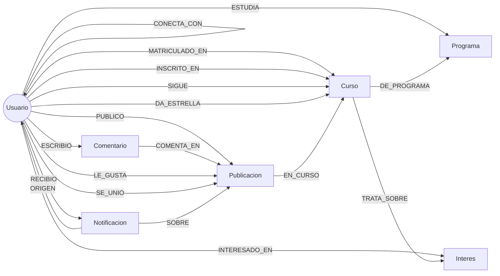

# Modelo del grafo

Documento vivo. Responsable: Jeronimo Castro. Cualquier cambio al modelo se avisa al grupo y se actualiza aquí.

## Diagrama

## Nodos

| Nodo           | Propiedades                                                                                         | Notas                                                                                                          |
| -------------- | --------------------------------------------------------------------------------------------------- | -------------------------------------------------------------------------------------------------------------- |
| `Usuario`      | `id`, `nombre`, `apellido`, `email`, `codigo`, `semestre`, `bio`, `password_hash`, `fecha_registro` | `id`, `email` y `codigo` únicos. Nunca se guarda la contraseña en claro                                        |
| `Programa`     | `id`, `codigo`, `nombre`, `facultad`                                                                | Carrera                                                                                                        |
| `Curso`        | `id`, `codigo`, `nombre`, `descripcion`, `creditos`, `nivel`, `periodo`                             | `nivel` es el semestre típico del curso                                                                        |
| `Interes`      | `nombre`                                                                                            | Único. Ej.: Programación, Música                                                                               |
| `Publicacion`  | `id`, `tipo`, `contenido`, `fecha` y, según el tipo, `enlace`, `actividad`, `cupos`, `estado`       | `tipo`: `GENERAL`, `MATERIAL`, `PREGUNTA`, `BUSCA_GRUPO`. `estado` (solo `BUSCA_GRUPO`): `ABIERTA` o `CERRADA` |
| `Comentario`   | `id`, `contenido`, `fecha`                                                                          |                                                                                                                |
| `Notificacion` | `id`, `tipo`, `mensaje`, `leida`, `fecha`                                                           | `tipo`: `SOLICITUD_CONEXION`, `CONEXION_ACEPTADA`, `COMENTARIO`, `LIKE`, `RESPUESTA_GRUPO`                     |

## Relaciones

| Relación                                    | Propiedades                                  | Significado                                                             |
| ------------------------------------------- | -------------------------------------------- | ----------------------------------------------------------------------- |
| `(Usuario)-[:ESTUDIA]->(Programa)`          |                                              | Carrera del usuario                                                     |
| `(Usuario)-[:INTERESADO_EN]->(Interes)`     |                                              | Gustos                                                                  |
| `(Usuario)-[:CONECTA_CON]->(Usuario)`       | `estado` (`PENDIENTE` o `ACEPTADA`), `desde` | La dirección indica quién envió la solicitud. Se consulta sin dirección |
| `(Usuario)-[:MATRICULADO_EN]->(Curso)`      | `periodo`                                    | Registro académico simulado: fuente de verdad para verificar matrícula  |
| `(Usuario)-[:INSCRITO_EN]->(Curso)`         | `desde`                                      | Inscrito en la plataforma. Solo si existe `MATRICULADO_EN`              |
| `(Usuario)-[:SIGUE]->(Curso)`               | `desde`                                      | Acceso al material sin estar matriculado                                |
| `(Usuario)-[:DA_ESTRELLA]->(Curso)`         | `fecha`                                      | Una por usuario y curso                                                 |
| `(Curso)-[:DE_PROGRAMA]->(Programa)`        |                                              | Carreras a las que aplica el curso                                      |
| `(Curso)-[:TRATA_SOBRE]->(Interes)`         |                                              | Temas del curso                                                         |
| `(Usuario)-[:PUBLICO]->(Publicacion)`       |                                              | Autor                                                                   |
| `(Publicacion)-[:EN_CURSO]->(Curso)`        |                                              | Opcional: publicación del muro de un curso                              |
| `(Usuario)-[:ESCRIBIO]->(Comentario)`       |                                              | Autor del comentario                                                    |
| `(Comentario)-[:COMENTA_EN]->(Publicacion)` |                                              | Publicación comentada                                                   |
| `(Usuario)-[:LE_GUSTA]->(Publicacion)`      | `fecha`                                      |                                                                         |
| `(Usuario)-[:SE_UNIO]->(Publicacion)`       | `fecha`                                      | Integrante de un grupo (`BUSCA_GRUPO`)                                  |
| `(Usuario)-[:RECIBIO]->(Notificacion)`      |                                              | Destinatario                                                            |
| `(Notificacion)-[:ORIGEN]->(Usuario)`       |                                              | Quién la generó                                                         |
| `(Notificacion)-[:SOBRE]->(Publicacion)`    |                                              | Publicación relacionada                                                 |

## Reglas de negocio

- **Seguir** un curso: cualquier usuario, sin verificación. Da acceso al material.
- **Inscribirse**: solo si existe `MATRICULADO_EN`. Al inscribirse se elimina `SIGUE` (son excluyentes).
- **Estrella**: solo quien sigue o está inscrito. Una por usuario y curso.
- **Publicar material y pedir grupo** (`MATERIAL`, `BUSCA_GRUPO`): solo inscritos. **Preguntar**: inscritos y seguidores.
- **Grupo**: los demás inscritos responden con comentario o `SE_UNIO`. Al llenarse los `cupos`, el `estado` pasa a `CERRADA`.
- **Recomendar cursos**: filtro por carrera del usuario (`DE_PROGRAMA`); después, intereses en común, cursos que siguen usuarios parecidos y estrellas.
- **Recomendar personas**: conexiones en común, cursos compartidos, misma carrera e intereses en común.

## Pendiente (fases posteriores)

- Nodo `Profesor` y relación `DICTA`, para recomendar profesores.
